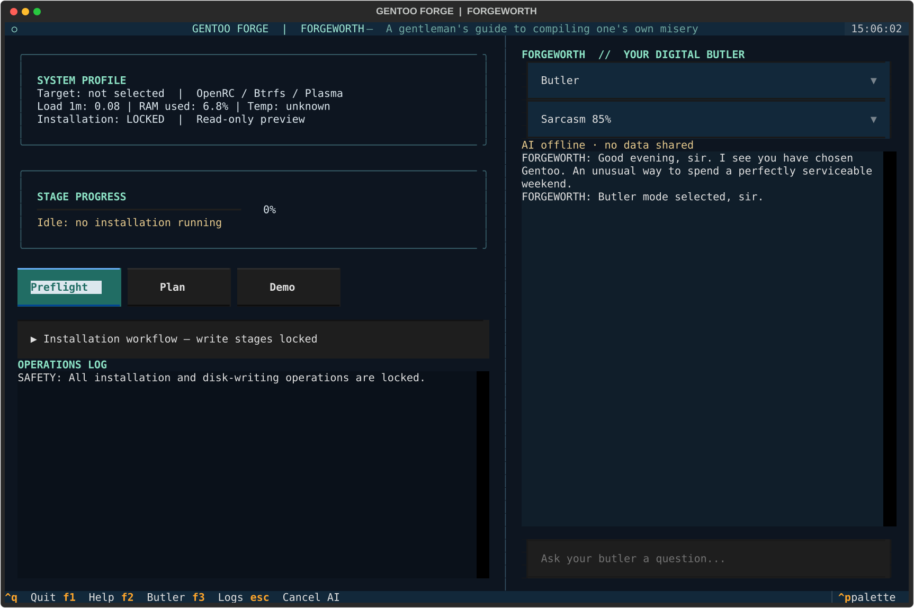

# FORGEWORTH

A responsive Textual inspection console and optional Codex conversational butler.
Installation writes remain locked pending isolated VM qualification.

## Setup and launch

Requires Linux, Python 3.11+, bash, lsblk and findmnt. Run as an ordinary user:

```bash
python3 -m venv .venv
. .venv/bin/activate
pip install -r tui/requirements.txt
python -m tui.app
```

Preflight streams real read-only host information. Plan uses
`config/hardware.env` copied from the example and requires an explicitly selected
unmounted whole disk. It never modifies that disk. Demo is clearly simulated.
Unknown operation duration uses indeterminate progress. No package or elapsed-time
completion estimate is fabricated. Narrow terminals stack the panes vertically.

F1 help, F2 chat, F3 logs, Escape cancel AI, Ctrl+Q quit, Tab/Shift+Tab navigate.
Expand the workflow to inspect stage state. Select Butler, Engineer, Roast or
Emergency and sarcasm intensity. Emergency always suppresses sarcasm. Telemetry
is host load and memory; missing or unidentified CPU temperature is unknown.

## Codex authentication and data sharing

Install Codex CLI separately. Check `codex --version`, `codex exec --help` and
`codex login --help` for your version. Authenticate with `codex login` or, where
supported, `codex login --device-auth`; inspect `codex login status`. Do not paste
keys into chat or configuration. A reported login can still be expired.

```bash
FORGEWORTH_CODEX=1 python -m tui.app
```

Opt-in sends your question, bounded recent conversation and read-only stage
metadata to the configured Codex provider. The activity line makes this visible.
History is held in memory until exit. Logs and telemetry are not automatically
shared. Requests time out after 90 seconds; Escape terminates their process group.
Authentication, offline and incompatible-CLI failures leave inspection available.
No live inference succeeded in this development environment: the session returned
401 despite `login status` reporting a login. Backend behavior is mock-tested.

`FORGEWORTH_CODEX` defaults off. `XDG_STATE_HOME` defaults to `~/.local/state`;
inspection checkpoints live under `gentoo-forge/checkpoint.json`. They record
inspection states, not installation authority. Invalid checkpoints currently
fail startup; move the file aside to repeat inspection. The legacy terminal menu
(`python tui/forgeworth.py`) remains available without Textual.

## Development and verification

```bash
python -m unittest discover -s tests -v
bash tests/validate.sh
```

Tests use fake inventories, subprocess fixtures, temporary checkpoints and Textual
headless pilots. They never partition a disk or call a live model. CI runs both
Python and shell checks. See [architecture](ARCHITECTURE.md),
[security](SAFETY.md) and [installation qualification](INSTALLATION-TARGET.md).


