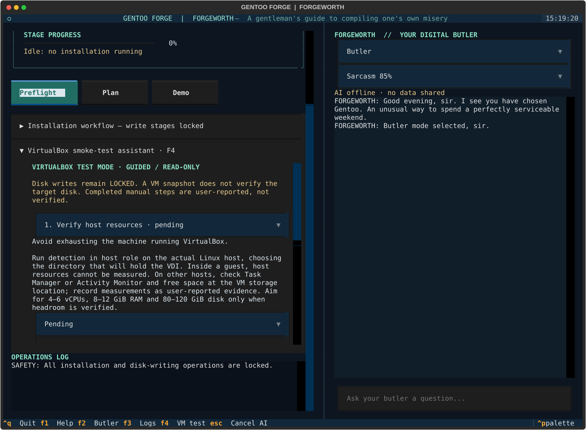

# VirtualBox guided smoke-test assistant

This milestone guides VM preparation, runs safe diagnostics and exports truthful
reports. **It does not install Gentoo.** Bootstrap through finalization remain
locked. No VirtualBox installation or successful installed-disk boot has been
verified in this development environment.

## Start the guide

Follow [development setup](FORGEWORTH-TUI.md), then run:

```bash
python -m tui.app --virtualbox
```

Or press **F4** in the existing TUI. The guide occupies a scrollable left panel;
chat remains on the right. Tab/Shift+Tab navigate controls; F2 focuses chat. The
workflow is useful without Codex, including all of these questions:

- How do I configure VirtualBox?
- Why isn't the VM booting?
- Which disk is safe to select?
- What is the installer doing?
- Why did GRUB fail?
- How do I recover from this error?

Offline answers explicitly provide documented guidance, current recorded results
and available local observations. They do not pretend to diagnose a failure for
which no evidence exists. Disk-selection and destructive questions use serious,
local deterministic guidance even when Codex is enabled. Emergency mode and
zero sarcasm suppress the offline setup banter. Other enabled AI questions receive
bounded stage/checklist/detection context, not raw diagnostics or identifiers.

## Prepare the host

Choose **On actual Linux host** and enter the directory where the VDI will live,
then **Detect (read-only)**. The collector measures local logical CPU count,
one-minute load, available RAM and filesystem free space. It recommends within
4–6 vCPUs, 8–12 GiB RAM and 80–120 GiB disk only if the snapshot of resources can
leave two CPU slots after rounded-up load, 4 GiB available RAM and 10 GiB storage
free. Thus a minimum suggestion requires at least six otherwise-idle logical CPUs,
12 GiB available RAM and 90 GiB free at the VDI location. Recommendations are
conditional; recheck competing workloads before starting the VM. Dynamic VDI
allocation does not guarantee future free capacity.

**Inside guest** is the default. Guest resources never establish host headroom;
detected VirtualBox or a known container prevents host recommendations. “Not
detected” means no VirtualBox signature in available DMI data, not proof of bare
metal. Confirm the scope yourself. Missing measurements mean no recommendation.
The host collector currently supports Linux only. On Windows/macOS check Task
Manager/Activity Monitor and free storage, then record measurements as
**user-reported** evidence rather than claiming the application verified them.

## Create and boot a disposable VM

These are manual instructions; the guide never runs VBoxManage or changes a VM.

1. In VirtualBox Manager create a Linux/Gentoo 64-bit (or Other Linux 64-bit) VM.
   Skip unattended installation. Use host-approved resource allocations only.
2. Create a **new** 80–120 GiB dynamically allocated VDI on the measured filesystem.
   Never attach a raw host disk, an important VDI or an unneeded shared folder.
3. Enable EFI under System. Configure NAT networking with the cable connected.
   Use VMSVGA, 128 MiB video memory and initially disable 3D acceleration.
4. Obtain the current official Gentoo amd64 ISO, preferably LiveGUI if a richer
   live environment is needed. Verify its signature and digest using the
   [Gentoo Handbook](https://wiki.gentoo.org/wiki/Handbook:AMD64/Full/Installation).
5. Under Storage, select the optical drive, choose the ISO file, and put optical
   before disk in boot order. Start the VM. An EFI shell can indicate an absent
   ISO or wrong boot entry; inspect the firmware boot manager before changing disks.
6. Confirm networking and Python/git availability in the guest. Obtain this
   repository on `feature/forgeworth-tui`, create a user-writable virtual
   environment and install `tui/requirements.txt` as in the TUI guide. Launch
   `python -m tui.app --virtualbox` under an unprivileged account.

Minimal Gentoo media may lack git, working venv/ensurepip, or enough writable
space for development tools. Check `python3 --version`, `git --version` and
`python3 -m venv .venv` first. Use suitable official LiveGUI media or prepare the
repository and dependencies on separate explicitly chosen persistent storage if
needed. This application does not provision missing live-media tools automatically.
Keep Codex disabled if no suitable unprivileged authenticated session is available.
See the [VirtualBox manual](https://www.virtualbox.org/manual/) for version-specific
EFI, graphics and snapshot UI details.

## Run the available safe workflow

Select **Inside guest** and **Detect**. DMI yields **detected**, **not detected** or
**cannot be determined**. Detection records actual command arguments, results,
timestamps, nonzero exits, missing tools and timeouts. It uses only fixed read-only
`lsblk`, `lspci`, `ip`, `findmnt` and PID-1 inspection commands. It also observes
local EFI state, memory, DMI and swaps. No device is opened for writing.

The disk selector lists whole disks with capacity, model, serial, WWN and UUID
where available. No disk is selected automatically. Select one explicitly and
use **Validate selection** to collect fresh diagnostics and apply the shared disk
validator. It rejects mounted descendants, active swap, unknown root/swap state,
missing serial/model, read-only targets and incomplete identities. Unresolved
swapfile/mapper ancestry and non-device root sources block validation. Some
VirtualBox disks do not expose a usable serial: that blocks validation, rather
than weakening the physical-disk policy. Validation is not erase authorization
and does not establish disposability. Compare the identity with the VM's attached
VDI in VirtualBox Manager.

Take a named VirtualBox snapshot before any future destructive stage. **A snapshot
is not a substitute for verifying the target disk.** Future writes still require
fresh deterministic identity/ancestry checks, deliberate `--nuke-it` authorization
and a separate exact interactive disk-identity confirmation. This milestone has
no enabled write path or authorization override.

Run **Preflight** in the main panel for an actual safe script execution. Its
observed result and a bounded sanitized log excerpt are saved while test mode is
open. **Demo** never counts as evidence. Select each checklist stage, select
pending/completed/failed/skipped and enter evidence or a reason before **Record
result**. Manual results are always tagged **user-reported**. In this release,
record installation as skipped because its executor is locked. Reboot and
installed-system checks stay pending or skipped, not automatically successful.

## Graphics and later acceptance checks

The physical Ryzen/Radeon target profile is not applied inside the VM. The guide
collects PCI display functions and their associated driver lines. VMSVGA commonly
uses vmwgfx/Mesa; other VirtualBox adapters may use vboxvideo. Actual driver and
session support must be inspected in the guest. Missing lspci means unknown graphics,
not an inferred Radeon card. The guide does not write physical AMDGPU/RADV settings.

Separate steps explain the purpose and suggested commands for installed UEFI,
GRUB boot, OpenRC, networking, root/home/swap mounts and Plasma/Wayland/XWayland.
Suggested commands are labelled **NOT executed**. Observations from the ISO or
this application's host environment do not verify the installed VDI. A later
milestone must install, shut down, detach the ISO, boot the VDI and record actual
results. Hibernation and Btrfs rollback are separate, initially unverified tests;
VirtualBox Save State is not hibernation, and creating snapshots is not verified
rollback. Mark unsupported features skipped with supporting evidence.

## Reports, persistence and PR attachments

The guide saves a versioned JSON report after observations, recorded results and
validation. The default location is
`$XDG_STATE_HOME/gentoo-forge/virtualbox-smoke.json` (normally
`~/.local/state/gentoo-forge/virtualbox-smoke.json`). Override it before launching:

```bash
FORGEWORTH_VBOX_REPORT=/path/you-chose/virtualbox-smoke.json python -m tui.app --virtualbox
```

The path must end in `.json`. Choosing a report path never mounts or selects a
disk. **Export report** saves that JSON plus a concise `.txt` summary beside it.
Files are replaced atomically with mode 0600. Existing reports resume the checklist;
live target validation is reset at restart, role change and diagnostics refresh.
Invalid reports are preserved and editing is blocked until you choose a new path
or repair the file. Reports are unsigned evidence records, not authorization tokens.

JSON contains suggested configuration (labelled as such), observed local hardware,
up to ten diagnostic collections, user-reported results, errors and bounded logs.
It never changes `installation_smoke_test` from `unverified` in this milestone.
Common credential patterns are redacted, and no environment/authentication dumps
are collected, but serials, mount paths, network routes and evidence notes can be
private. Review both exports before attaching them to a GitHub PR. Do not enter
secrets as evidence. Export does not upload or post anything.

Copy reports off volatile ISO storage **before reboot**, using storage or a network
copy destination you explicitly selected. After booting an installed guest in a
future milestone, restore that file and select its path to continue the checklist.
Never interpret a persisted validation as authorization for a current device.

## Testing and current limits

`python -m unittest discover -s tests -v` includes mocked VirtualBox/DMI/PCI/disk
inventories, low and unknown host resources, missing tools/timeouts, report
persistence/redaction, all result states, disk rejection and headless UI tests.
The UI tests exercise report export, explicit target choice, offline safety replies
and conversation while detection remains in flight. Existing CI discovers them.
No test partitions a real disk, creates a VM or calls a live model.

A read-only probe was exercised on the development environment; it could not
determine VirtualBox and reported missing/incomplete tooling honestly. There is
no VirtualBox hypervisor attached here, so VM creation, Gentoo installation,
VDI boot, graphical login, hibernation and rollback remain **unverified**.


